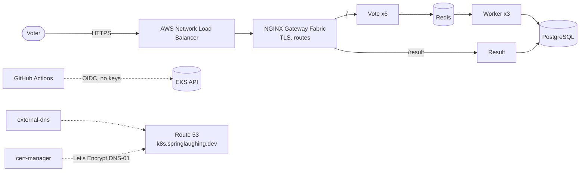

# Voting App on EKS

Ironhack DevOps, Project 2. The voting app from Project 1 (Vote, Result, Worker, Redis, PostgreSQL)
on Kubernetes in Amazon EKS: behind a Gateway with HTTPS on its own domain, deployed by GitHub
Actions with no stored cloud keys, and load-tested under updates.

**Live (while the cluster runs):** https://k8s.springlaughing.dev/vote and
https://k8s.springlaughing.dev/result

## Architecture



- **Cluster:** 3 × t3.medium in us-east-1 (`eks-evgenia`), from the class Terraform (`eks-quick-terraform`).
  Everything on top of it is in this repo.
- **Traffic:** one NLB → NGINX Gateway Fabric 1.5.1 (Gateway API) → `/result` to Result, everything else to Vote.
- **Data:** Redis and PostgreSQL each on their own EBS volume (`gp3`). The database password lives only in
  AWS Secrets Manager (`voting/db-password`) and is copied into a Kubernetes Secret at setup; never printed, never in Git.
- **HTTPS:** `k8s.springlaughing.dev` is a Route 53 zone delegated from Porkbun (4 NS records). external-dns writes the
  name, cert-manager gets the certificate from Let's Encrypt (DNS-01). Both reach Route 53 through EKS Pod Identity,
  each limited to that one zone. HTTPS only, no HTTP redirect: `.dev` is on the browsers' HSTS preload list.

## What's where

| Path | What |
| --- | --- |
| `vote/`, `result/`, `worker/` | The three app images (from Project 1) |
| `k8s/app/` | The app: Deployments, the Worker StatefulSet, Services, HTTPRoute. The pipeline applies these |
| `k8s/platform/` | Applied once at setup: namespace, StorageClass, Gateway, certificate, ClusterIssuers, pipeline RBAC, Helm values |
| `terraform/iam/` | IAM: the GitHub OIDC role `gha-voting-deploy-evgenia` (trusts `main` only), Pod Identity roles for external-dns and cert-manager, the Secrets Manager secret |
| `terraform/dns/` | The Route 53 zone `k8s.springlaughing.dev`. Kept between cluster rebuilds |
| `setup-cluster.sh` | Everything on a fresh cluster: Gateway API, NGINX Gateway Fabric, external-dns, cert-manager, platform, Secret, pipeline access, the app, smoke test |
| `teardown.sh` | Removes it again in a safe order (namespace, EBS volumes, DNS records, NLB, cert-manager) before the cluster goes |
| `smoke-test.sh` | Pages through the Gateway plus one vote all the way into PostgreSQL |
| `.github/workflows/ci-cd.yml` | Pull request: build only. Push to `main`: build, push to Docker Hub (tag = commit ID), deploy, smoke test |
| `.github/workflows/oidc-check.yml` | Proves the OIDC role works from `main` and is refused from other branches |
| `loadtest/` | k6 scripts, samplers and test scripts; every run's raw results are in `loadtest/results/` |

## Run it

```bash
# 1. The cluster (class Terraform). Set the node count on the FIRST apply:
#    the EKS module ignores desired_size afterwards.
cd ~/ironhack/eks-quick-terraform && TF_VAR_desired_nodes=3 ./up.sh evgenia

# 2. Everything on top (safe to run again)
cd ~/ironhack/ironhack-project-2 && ./setup-cluster.sh evgenia

# 3. Deploy the current images: any push to main, or by hand
gh workflow run ci-cd.yml --ref main

# Check
./smoke-test.sh
```

Tear down, in this order (otherwise the NLB, the EBS volumes or the DNS records are left behind):

```bash
./teardown.sh evgenia
cd ~/ironhack/eks-quick-terraform && ./down.sh evgenia
```

`terraform/iam/` and `terraform/dns/` are applied once by hand and survive rebuilds.

## Load test results (#9)

Scenario: a live-event vote, 50 votes/s, plus a spike of 400 votes/s for 5 s ("vote now", Project 1's spike).
Goal: 95 of 100 voters answered within 0.5 s, and no vote lost, also during an update.
k6 runs in AWS CloudShell, inside AWS.

| Finding | Numbers |
| --- | --- |
| One Vote pod at its CPU limit answers ~90 votes/s. 6 pods carry the spike even with one missing | 2 pods: 190 votes/s, median wait 2.65 s · 6 pods: 95 of 100 within 0.43 s |
| Readiness probe + preStop: no vote lost during an update | defaults: 67 votes lost · with both: 0, in every update run since (~55,000 votes) |
| Every update is slow: NGINX reloads on each change to the pod list (~20 per rolling update) | no update 0.43 / 0.46 s · rolling update 2.09 / 1.89 s · blue-green (1 reload) 0.77 s |
| `maxUnavailable: 0` doesn't help: a missing pod wasn't the cause | 0.85 s either way |
| Where the pods sit matters: one crowded node slows the whole spike | 2 + 2 + 2: 0.46 s · 3 Vote pods on the NGINX node: 1.32 s (repeat: 0.58 → 1.15 s) |
| A node that joins (or replaces a failed one) starts empty; Kubernetes moves nothing to it | after a 2-node start, the 3rd node held only Vote until the next deploy |

What changed in the app because of it: 6 Vote replicas, readiness probe on `/vote`, `preStop` sleep 10 s,
and a spread rule with `matchLabelKeys: [pod-template-hash]` so every update ends 2 + 2 + 2.

Next steps a production team would take: reserve real CPU (Vote 0.4 instead of 0.1; NGINX has none), 2 NGINX pods
spread over nodes, spread and keep-apart rules for the other components, spare room plus an autoscaler, and a
rebalancer (descheduler or Karpenter) after node changes.

## How the work was done

One issue per step, a branch per issue, Conventional Commits, PRs with `Closes #N` (see `CONTRIBUTING.md`).
A detailed work log with every command and output was kept alongside.
Prepared with help from an AI (Claude) for explanations, planning and the slides; the cluster, the runs and the
decisions are mine.
